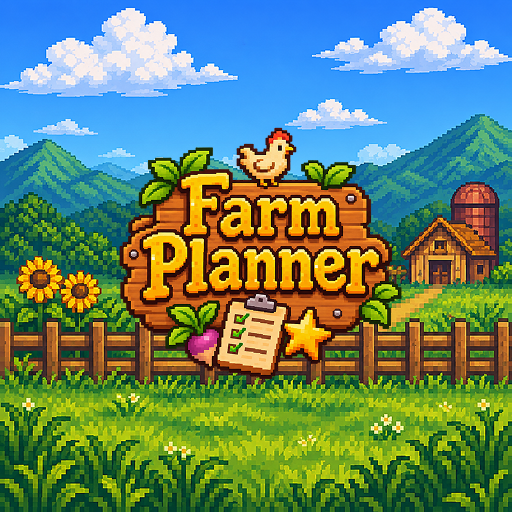

<p align="center">
  
</p>

<h1 align="center">Stardew Farm Planner</h1>

<p align="center">
  <strong>Планировщик фермы для Stardew Valley</strong><br />
  Календарь посадок · культуры · рыбалка · общественный центр
</p>

<p align="center">
  <a href="#-русский">Русский</a> · <a href="#-english">English</a>
</p>

<p align="center">
  <a href="https://github.com/GoblinThug/Stardew-Farm-Planner/actions/workflows/android-apk.yml"></a>
  
  
</p>

<p align="center">
  <a href="https://github.com/GoblinThug/Stardew-Farm-Planner/actions/workflows/android-apk.yml"><strong>⬇️ Собрать и скачать APK через GitHub Actions</strong></a>
  &nbsp;·&nbsp;
  <a href="https://github.com/GoblinThug/Stardew-Farm-Planner/issues">Сообщить о проблеме</a>
</p>

---

# 🇷🇺 Русский

## ✨ Что это

**Stardew Farm Planner** — мобильный помощник для планирования фермы в Stardew Valley. Приложение объединяет календарь посадок, справочник культур, рыбалку и планирование наборов общественного центра.

## 📚 Возможности

| Раздел | Что доступно |
|---|---|
| 📅 Календарь | Выбор сезона, дня и года; добавление посадок и просмотр ожидаемого урожая |
| 🌱 Культуры | Список культур с сезонами и местами выращивания, сроками роста и повторного урожая |
| 🎣 Рыбалка | Поиск и фильтрация рыбы по сезону, категории и условиям ловли; отметка пойманной рыбы |
| 🎁 Наборы | Просмотр наборов общественного центра и их вариантов; изображения наборов и предметов |
| 💾 Локальные данные | Состояние некоторых отметок сохраняется на устройстве с помощью AsyncStorage |

Данные приложения находятся в `data/`, а локальные изображения — в `assets/`.

## 📱 Скриншоты

<!-- Добавь скриншоты приложения в docs/screenshots/ и вставь их ниже. -->
<!--
<p align="center">
  
  
  
</p>
-->

## ⬇️ Скачать APK

Готовый APK собирается автоматически через **GitHub Actions**.

1. Открой вкладку **Actions** репозитория.
2. Выбери workflow **Android APK**.
3. Нажми **Run workflow** (или дождись автоматической сборки после push в `main`).
4. Открой завершившийся запуск.
5. Внизу страницы в разделе **Artifacts** скачай `farm-planner-release-apk`.

Архив Artifact содержит `app-release.apk`. GitHub хранит Artifact ограниченное время согласно настройкам репозитория.

## 🚀 Запуск проекта локально

Нужны Node.js LTS, npm и Android Studio/Android SDK для запуска на Android.

```bash
npm ci
npx expo start
```

Для запуска на подключённом Android-устройстве с настроенным SDK:

```bash
npx expo run:android
```

## 🧱 Структура проекта

```text
.
├── App.js
├── app.json
├── assets/
│   ├── bundles/
│   ├── crops/
│   ├── fish/
│   ├── items/
│   ├── profile/
│   └── ui/
├── data/
│   ├── bundles.json
│   ├── crops.json
│   ├── fish.json
│   └── *.json
└── src/
    ├── data/appData.js
    └── styles/styles.js
```

## 🧩 Данные и изображения

- `data/crops.json`, `data/crop-details.json`, `data/crop-rules.json` — сведения о культурах и правилах выращивания.
- `data/fish.json`, `data/fish-rules.json` — сведения о рыбе и правилах рыбалки.
- `data/bundles.json` — данные наборов.
- `data/crop-images.json`, `data/fish-images.json`, `data/bundle-item-icons.json` — сопоставления изображений.
- `data/bundle-image-manifest.json` — названия файлов изображений наборов и соответствующие локальные имена.
- `assets/` — PNG-изображения, используемые приложением локально.

## 🛠️ Сборка Android через GitHub Actions

Workflow расположен в [`.github/workflows/android-apk.yml`](.github/workflows/android-apk.yml).

Он запускается вручную через **Run workflow**, а также при push в `main`. Workflow устанавливает Node.js и Java, устанавливает зависимости, генерирует Android-проект с помощью Expo Prebuild, собирает Release APK и загружает APK как Artifact.

Сборка не требует хранить `android/`, `local.properties`, Android SDK или ключи подписи в репозитории. Полученный APK предназначен для тестирования и установки вручную; это не публикация в Google Play.

## ⚖️ Авторские права и сторонние материалы

Stardew Valley и связанные игровые материалы принадлежат их правообладателям. Название игры используется только для обозначения совместимости/тематики приложения. Наличие изображений игровых предметов, рыб, культур и наборов в репозитории не означает передачу прав на эти материалы.

Перед публичным распространением проверь права и условия использования каждого изображения и набора данных. Не заявляй, что проект официально связан с ConcernedApe или Stardew Valley.

Код приложения и игровые ресурсы — разные категории материалов. Для этого репозитория пока не назначена единая лицензия, которая распространялась бы на всё содержимое.

## 🐞 Проблемы и предложения

Нашёл ошибку или хочешь предложить улучшение? Создай [Issue](https://github.com/GoblinThug/Stardew-Farm-Planner/issues).

---

# 🇬🇧 English

## ✨ About

**Stardew Farm Planner** is a mobile companion for planning a Stardew Valley farm. It brings together a planting calendar, crop reference, fishing information, and Community Center bundle planning.

## 📚 Features

| Section | What it includes |
|---|---|
| 📅 Calendar | Choose a season, day, and year; add plantings and review expected harvests |
| 🌱 Crops | Crop reference with seasons, growing locations, growth time, and regrowth information |
| 🎣 Fishing | Browse and filter fish by season, category, and catch conditions; mark fish as caught |
| 🎁 Bundles | Browse Community Center bundles and variants, with bundle and item images |
| 💾 Local data | Some progress markers are stored on-device using AsyncStorage |

Application data is stored in `data/`, and local images are stored in `assets/`.

## ⬇️ Download the APK

The APK is built automatically with **GitHub Actions**.

1. Open the repository's **Actions** tab.
2. Select **Android APK**.
3. Click **Run workflow**, or push a change to `main`.
4. Open the completed workflow run.
5. Download `farm-planner-release-apk` from **Artifacts**.

The artifact ZIP contains `app-release.apk`. Artifacts are retained for a limited time according to repository settings.

## 🚀 Run locally

Requirements: Node.js LTS, npm, and Android Studio/Android SDK for Android device builds.

```bash
npm ci
npx expo start
```

To build and run on a connected Android device with the SDK configured:

```bash
npx expo run:android
```

## 🛠️ Android build with GitHub Actions

The workflow is [`.github/workflows/android-apk.yml`](.github/workflows/android-apk.yml). It can be started manually or on pushes to `main`. It installs dependencies, runs Expo Prebuild, builds a Release APK, and uploads the APK as a downloadable artifact.

The workflow does not require committing the generated `android/` directory, `local.properties`, the Android SDK, or signing keys. The resulting APK is for testing and manual installation, not a Google Play release.

## ⚖️ Copyright and third-party materials

Stardew Valley and its game assets belong to their respective rights holders. This project is an unofficial fan-made companion and is not affiliated with or endorsed by ConcernedApe or Stardew Valley.

Images, item sprites, fish, crops, bundle artwork, and game-related data may have separate rights and usage terms. Review the permissions and terms for each resource before redistributing this repository or its contents.

No single license is currently assigned to the entire repository.

## 🐞 Issues

Please report bugs and feature requests via [GitHub Issues](https://github.com/GoblinThug/Stardew-Farm-Planner/issues).
